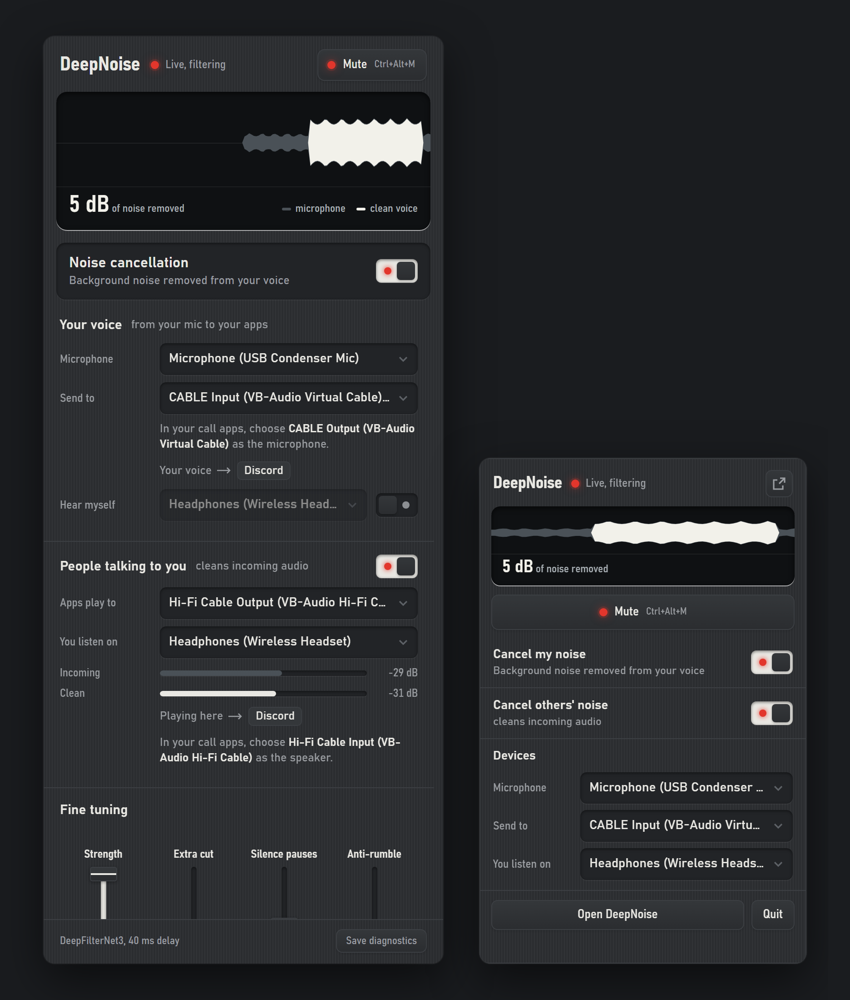

<p align="center"></p>

<h1 align="center">DeepNoise</h1>

<p align="center">
  <b>Real-time AI noise cancellation for Windows, for your microphone and for the people you're talking to.</b><br>
  Neural noise suppression, echo cancellation and a virtual microphone in a small tray app.<br>
  Runs locally, offline, with no account. Open source.
</p>

<p align="center">
  
  
  
  
</p>

<p align="center">
  <a href="docs/README.pt-BR.md">Português (Brasil)</a> ·
  <a href="#install">Install</a> ·
  <a href="#build-from-source">Build from source</a> ·
  <a href="#documentation">Documentation</a>
</p>

<br>

<p align="center">
  
  <br>
  <sub>The main window and the tray quick-actions panel (demo data). The scope draws the raw microphone in grey under the clean voice in white: the grey left over is the noise being removed.</sub>
</p>

## Features

- **Cancels your noise**: keyboard, fans, clapping, street noise. Neural suppression with
  [DeepFilterNet3](https://github.com/Rikorose/DeepFilterNet), 10 ms frames at 48 kHz, ~40 ms of delay.
- **Cancels other people's noise** in your calls (incoming audio).
- **Echo cancellation** (WebRTC AEC3) when you use speakers instead of headphones.
- **Virtual microphone**: pick `CABLE Output` in Discord, Zoom, Teams, OBS…
- **Fine tuning**: strength (dry/wet), extra suppression, silence between words, anti-rumble high-pass,
  distant-voice suppression (experimental).
- **Device control**: microphone volume lock against apps that change it, global mute hotkey (**Ctrl+Alt+M**),
  which apps are using your voice, auto-reconnect when devices come and go.
- **Tray app**: a quick-actions panel above the clock, start with Windows, single instance.
- Interface in **English** and **Português (Brasil)**.

## Under the hood

- **One audio thread owns the hardware**: PortAudio (WASAPI) streams and Windows Core Audio (COM) objects
  are created and released on a single MTA thread; a watchdog reopens devices by name when a stream dies.
- **Microphone chain**: high-pass → AEC3 → DeepFilterNet3 → distant-voice gate → pause gate with hold →
  dry/wet blend → mute → virtual cable, plus an optional "hear myself" monitor.
- **Speaker chain**: incoming call audio from a second virtual cable → DeepFilterNet3 → your headphones; it also
  feeds the echo canceller's reference.
- **Native plugin, no model conversion**: the official DeepFilterNet LADSPA plugin is hosted through `ctypes`,
  downloaded at build time and verified by SHA-256.
- **Native windows**: the UI is HTML rendered by the Edge WebView2 runtime through pywebview; a loopback-only HTTP API
  connects it to the engine and refuses cross-origin requests.
- **Tested without hardware**: unit tests, HTTP API tests and UI contract checks run without opening audio devices.

> [!IMPORTANT]
> **Status:** DeepNoise is a **preview**. It has been tested on a single Windows 11 setup; microphone,
> speaker and reconnection behaviour still need validation across more hardware ([roadmap](ROADMAP.md)). The
> "Background voices" option is a level heuristic, not a trained voice-separation model. A licensing item for the
> echo-cancellation library is still open in [`docs/LICENSE_AUDIT.md`](docs/LICENSE_AUDIT.md). Please file issues
> with your Windows version, audio devices and the log from `%APPDATA%\DeepNoise\logs\deepnoise.log`.

## Install

1. Download `DeepNoise-<version>-win64.zip` from [Releases](https://github.com/n3w3r4/Deep-Noise/releases),
   check it against `SHA256SUMS.txt`, and unzip it anywhere.
2. Optional, for use in other apps: right-click `install-drivers.ps1` → *Run with PowerShell*,
   accept the VB-Audio installers, restart Windows.
3. Run `DeepNoise.exe`. It lives in the system tray; closing the window keeps it running.

**Requirements:** Windows 10 or 11, 64-bit, with the Edge WebView2 runtime (install it from Microsoft if missing).
For the virtual microphone and the incoming-audio cleaner: **VB-CABLE** and **VB-Audio Hi-Fi Cable**
(donationware by [VB-Audio](https://vb-audio.com), not bundled).

### Use it in Discord / Zoom / Teams

| In DeepNoise | In your call app |
|---|---|
| **Your voice → Send to:** `CABLE Input` | **Microphone:** `CABLE Output (VB-Audio Virtual Cable)` |
| **People talking to you → Apps play to:** `Hi-Fi Cable Output`, **You listen on:** your headphones | **Speaker:** `Hi-Fi Cable Input (VB-Audio Hi-Fi Cable)` |

## Build from source

```powershell
git clone https://github.com/n3w3r4/Deep-Noise
cd Deep-Noise
py -3.14 -m venv .venv
.venv\Scripts\python.exe -m pip install --require-hashes -r requirements-lock.txt
.venv\Scripts\python.exe scripts\fetch_deps.py     # DeepFilterNet plugin -> vendor\ (SHA-256 checked)
run-dev.cmd                                        # run from source
.venv\Scripts\python.exe build.py                  # dist\DeepNoise\DeepNoise.exe + release zip + SHA256SUMS.txt
```

When running from source, settings and logs stay in the repo folder (git-ignored); the `.exe` uses
`%APPDATA%\DeepNoise`. New contributors and AI agents: start with [`AGENTS.md`](AGENTS.md), then
[`docs/DEVELOPMENT.md`](docs/DEVELOPMENT.md).

### Project layout

| Path | What |
|---|---|
| `app.py` | Entry point: app state, audio thread (watchdog, device scan), tray, windows, single instance |
| `local_api.py` | Loopback HTTP API checks (origin, request header, bounded JSON) |
| `engine.py` | Audio graph: microphone chain and speaker chain, device resolution, diagnostics recorder |
| `ladspa_df.py` | Minimal `ctypes` host for the DeepFilterNet LADSPA plugin |
| `mixer.py` | Dry/wet blend, noise gate with hold, high-pass |
| `winaudio.py` | Windows Core Audio: device list, volume lock, apps using a device, global hotkey |
| `windows.py`, `desktop.py` | Native windows (pywebview), tray icon, start with Windows |
| `realtime.py` | Keeps Windows from throttling the audio process |
| `ui/` | Interface: `index.html` (main window), `flyout.html` (quick actions), `i18n.js` (EN/PT), `api.js` |
| `assets/app-icon/` | App icon master, its README and license |
| `tools/` | `bench_file.py` (offline benchmark), `check_mic.py`, `analyze_diag.py` |
| `scripts/` | Native dependency fetch, VB-Audio installer, license and source collection, release verification |
| `tests/` | Unit, HTTP API and packaging tests (Python) and UI contract checks (Node) |
| `licenses/`, `packaging/` | Third-party license texts and native inventories; PyInstaller hooks and source pins |

## Troubleshooting

- **Log**: `%APPDATA%\DeepNoise\logs\deepnoise.log` (from source: `logs\`). Native crashes leave a Python stack there.
- **Save diagnostics** (footer of the main window) writes the last 60 s of mic, filtered and output audio
  to the logs folder; `tools\analyze_diag.py` reports levels, delay drift and repeated audio.
- If another noise-cancelling app (for example Krisp) uses the same microphone, DeepNoise warns you: close one of them.
- No sound at all with DeepNoise closed is not caused by DeepNoise; check your default output device and any
  audio router (SteelSeries Sonar, Elgato Wave Link…) output settings.

## Documentation

| Read | Why |
|---|---|
| [`AGENTS.md`](AGENTS.md) | Orientation for AI agents and contributors: rules, map, invariants |
| [`docs/DEVELOPMENT.md`](docs/DEVELOPMENT.md) | Set up, run, test, debug and use the diagnostics tools |
| [`docs/ARCHITECTURE.md`](docs/ARCHITECTURE.md) | Threads, audio graph, UI ↔ engine seam |
| [`docs/DECISIONS.md`](docs/DECISIONS.md) | Why things are the way they are |
| [`CONTRIBUTING.md`](CONTRIBUTING.md) | Language, tests, commits, licensing of contributions |
| [`docs/RELEASING.md`](docs/RELEASING.md), [`docs/PUBLISHING.md`](docs/PUBLISHING.md) | Release build, draft release and publication handoff |
| [`ROADMAP.md`](ROADMAP.md), [`CHANGELOG.md`](CHANGELOG.md) | Where it is and where it's going |

## Security

The local API, privacy of diagnostics and how to report a vulnerability are covered in [`SECURITY.md`](SECURITY.md).

## License and credits

DeepNoise is dual-licensed under [MIT](LICENSE-MIT) or [Apache-2.0](LICENSE-APACHE), at your option.
Copyright (c) 2026 the DeepNoise contributors. Required notices are in [NOTICE](NOTICE).

Bundled and downloaded components keep their own licenses: see [THIRD_PARTY_NOTICES.md](THIRD_PARTY_NOTICES.md),
[`licenses/`](licenses/) and the [native license review](docs/LICENSE_AUDIT.md). Every non-code asset is listed with
its author, source and license in [ATTRIBUTION.md](ATTRIBUTION.md). DeepNoise is built on
[DeepFilterNet](https://github.com/Rikorose/DeepFilterNet) by Hendrik Schröter and contributors.

<sub>Windows and Teams are trademarks of Microsoft Corporation; Krisp is a trademark of Krisp Technologies, Inc.;
Discord is a trademark of Discord Inc.; Zoom is a trademark of Zoom Communications, Inc.; VB-CABLE and VB-Audio are
trademarks of VB-Audio Software; SteelSeries Sonar and Elgato Wave Link belong to their respective owners.
DeepNoise is an independent, open-source project and is not affiliated with, sponsored by or endorsed by any of them;
these names are used only to describe compatibility.</sub>
