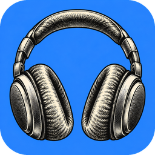

<p align="center"></p>

<h1 align="center">DeepNoise</h1>

<p align="center">Real-time AI noise cancellation for Windows: for your microphone and for the people you're talking to.<br>
<a href="#português">Português abaixo</a></p>

---

## What it does

- **Cancels your noise**: keyboard, fans, clapping, street noise. Neural suppression with
  [DeepFilterNet3](https://github.com/Rikorose/DeepFilterNet), 10 ms frames at 48 kHz, ~40 ms of delay.
- **Cancels other people's noise** in your calls (incoming audio).
- **Echo cancellation** (WebRTC AEC3) when you use speakers instead of headphones.
- **Virtual microphone**: pick `CABLE Output` in Discord, Zoom, Teams, OBS…
- Fine tuning: strength (dry/wet), extra suppression, silence between words, anti-rumble high-pass,
  distant-voice suppression (experimental), microphone volume lock, global mute hotkey (**Ctrl+Alt+M**).
- Tray icon with a **quick-actions panel**, start with Windows, auto-reconnect when devices come and go.
- Interface in **English** and **Português (Brasil)**.

## Requirements

- Windows 10 or 11, 64-bit (uses the Edge WebView2 runtime that ships with Windows).
- For the virtual microphone and the incoming-audio cleaner: **VB-CABLE** and **VB-Audio Hi-Fi Cable**
  (donationware by [VB-Audio](https://vb-audio.com)).

## Install (release)

1. Download `DeepNoise-<version>-win64.zip` from [Releases](../../releases) and unzip it anywhere.
2. Optional, for use in other apps: right-click `install-drivers.ps1` → *Run with PowerShell*,
   accept the VB-Audio installers, restart Windows.
3. Run `DeepNoise.exe`. It lives in the system tray; closing the window keeps it running.

### Use it in Discord / Zoom / Teams

| In DeepNoise | In your call app |
|---|---|
| **Your voice → Send to:** `CABLE Input` | **Microphone:** `CABLE Output (VB-Audio Virtual Cable)` |
| **People talking to you → Apps play to:** `Hi-Fi Cable Output`, **You listen on:** your headphones | **Speaker:** `Hi-Fi Cable Input (VB-Audio Hi-Fi Cable)` |

## Build from source

```powershell
py -3.14 -m venv .venv
.venv\Scripts\python.exe -m pip install -r requirements.txt
.venv\Scripts\python.exe scripts\fetch_deps.py     # DeepFilterNet plugin -> vendor\ (SHA-256 checked)
run-dev.cmd                                        # run from source
.venv\Scripts\python.exe build.py                  # dist\DeepNoise\DeepNoise.exe + dist\DeepNoise-<version>-win64.zip
```

When running from source, settings and logs stay in the repo folder (git-ignored); the `.exe` uses
`%APPDATA%\DeepNoise`.

### Project layout

| Path | What |
|---|---|
| `app.py` | Entry point: local HTTP API for the UI, audio thread (watchdog, device scan), tray, windows |
| `engine.py` | Audio graph: mic chain (high-pass → AEC → DeepFilterNet → gates → dry/wet) and speaker chain |
| `ladspa_df.py` | Minimal `ctypes` host for the DeepFilterNet LADSPA plugin |
| `mixer.py` | Dry/wet blend, noise gate with hold, high-pass |
| `winaudio.py` | Windows Core Audio: device list, volume lock, apps using a device, global hotkey |
| `windows.py`, `desktop.py` | Native windows (pywebview), tray icon, start with Windows |
| `realtime.py` | Keeps Windows from throttling the audio process |
| `ui/` | Interface (`index.html` main window, `flyout.html` quick actions, `i18n.js` PT/EN) |
| `tools/` | `bench_file.py` (offline benchmark), `check_mic.py`, `analyze_diag.py` |
| `scripts/` | `fetch_deps.py` (native deps), `install-drivers.ps1` (VB-Audio cables) |

## Troubleshooting

- **Log**: `%APPDATA%\DeepNoise\logs\deepnoise.log` (from source: `logs\`). Native crashes leave a Python stack there.
- **Save diagnostics** (footer of the main window) writes the last 60 s of mic, filtered and output audio
  to the logs folder; `tools\analyze_diag.py` reports levels, delay drift and repeated audio.
- If another noise-cancelling app (e.g. Krisp) uses the same microphone, DeepNoise warns you: close one of them.

## License

See [THIRD_PARTY_NOTICES.md](THIRD_PARTY_NOTICES.md) for the components DeepNoise uses.

---

## Português

**DeepNoise** cancela ruído em tempo real no Windows, no seu microfone e no som de quem fala com você.

- **Seu ruído**: teclado, ventilador, palmas, rua. Supressão neural com DeepFilterNet3, frames de 10 ms a 48 kHz, ~40 ms de atraso.
- **Ruído dos outros** nas chamadas, **cancelamento de eco** e **microfone virtual** para Discord, Zoom, Teams e OBS.
- Ajuste fino, travar volume do microfone, atalho global **Ctrl+Alt+M**, ícone na bandeja com **ações rápidas**,
  iniciar com o Windows e reconexão automática de dispositivos. Interface em português e inglês.

### Instalar

1. Baixe `DeepNoise-<versão>-win64.zip` em [Releases](../../releases) e descompacte.
2. Opcional, para usar em outros apps: clique com o botão direito em `install-drivers.ps1` → *Executar com o PowerShell*,
   aceite os instaladores da VB-Audio e reinicie o Windows.
3. Abra o `DeepNoise.exe`. Ele fica na bandeja; fechar a janela não encerra o app.

### Usar no Discord / Zoom / Teams

| No DeepNoise | No app de chamada |
|---|---|
| **Sua voz → Enviar para:** `CABLE Input` | **Microfone:** `CABLE Output (VB-Audio Virtual Cable)` |
| **Quem fala com você → Apps tocam em:** `Hi-Fi Cable Output`, **Você ouve em:** seu fone | **Alto-falante:** `Hi-Fi Cable Input (VB-Audio Hi-Fi Cable)` |

### Compilar

Os mesmos comandos de [Build from source](#build-from-source). O VB-CABLE e o Hi-Fi Cable são donationware da
VB-Audio (www.vb-cable.com) e não vêm no repositório: o `scripts\install-drivers.ps1` baixa do site oficial e confere a assinatura.
